# Ellia Health · "Where to Start" Instagram review (tonight + 21 posts)

Positioning: premium, consult-first, guided end to end. Hero: 20-minute consultation with a licensed clinician; free quiz is the easy alternative. Big idea: "The most valuable things are your wellness and your time. Ellia Health protects both."

All 22 posts are **scheduled in Buffer** (Instagram channel 6ae2d45f2f1f5ed64809a712, automatic publishing). Times are America/Los_Angeles (PT).
AI label: Instagram `isAiGenerated` is ON only for the 7 AI avatar Reels and OFF for all images/carousels. No caption mentions AI.

Compliance self-check (79 text items: captions, every slide, every Reel script): **PASS: 0 hits**. Checked: no exclamation marks, hashtags, prices; no prescription/medication/medicine/treatment/drug/dose/pharmacy/shipping/delivery/approved/weight/GLP-1/peptide/hormone or condition names; no outcome, before/after, testimonial, 'only', 'best', 'guaranteed', 'better version'; 'free' only next to the quiz; 'Ellia Health' always written in full; every caption ends with 'Learn more at ellia.health'.

| # | Date / time (PT) | Format | Hook | Buffer id |
|---|---|---|---|---|
| post-00-tonight | Tue 2026-11-03 8:30 PM PT | Single static | Your wellness and your time are the most valuable things you have. | `6aeaaa64b8d162e0d8006c7a` |
| post-01 | Wed 2026-11-04 8:00 AM PT | Carousel (7 slides) | Guided from the very first conversation. | `6aeaab9eff887f055ce7dc83` |
| post-02 | Wed 2026-11-04 12:30 PM PT | Single static | 20 minutes. Unrushed. | `6aeaaba0ff887f055ce7dcd9` |
| post-03 | Wed 2026-11-04 6:30 PM PT | Avatar Reel (15 s, talent A) | Not sure where to start? Start with a conversation. | `6aeaaba416e63068f190fde4` |
| post-04 | Thu 2026-11-05 8:00 AM PT | Carousel (6 slides) | Where to start: a conversation, or a quiz? | `6aeaabc216e63068f1910224` |
| post-05 | Thu 2026-11-05 12:30 PM PT | Single static | Health shouldn't be a bargain. | `6aeaabc5ff887f055ce7e21d` |
| post-06 | Thu 2026-11-05 6:30 PM PT | Avatar Reel (15 s, talent C) | The first conversation is just the beginning. | `6aeab00eb8d162e0d8023121` |
| post-07 | Fri 2026-11-06 8:00 AM PT | Carousel (6 slides) | Labs, as part of the process. | `6aeaabcdff887f055ce7e2e1` |
| post-08 | Fri 2026-11-06 12:30 PM PT | Single static | Your calendar, respected. | `6aeaabd069ad1ef03b75ee6c` |
| post-09 | Fri 2026-11-06 6:30 PM PT | Avatar Reel (15 s, talent B) | Here's what 20 minutes with a clinician at Ellia Health feels like. | `6aeaabd3ff887f055ce7e3fa` |
| post-10 | Sat 2026-11-07 8:00 AM PT | Carousel (6 slides) | Questions to bring to your 20-minute consultation. | `6aeaabdbb8d162e0d800d5ab` |
| post-11 | Sat 2026-11-07 12:30 PM PT | Single static | Never rushed. Never on your own. | `6aeaabdeb8d162e0d800d5eb` |
| post-12 | Sat 2026-11-07 6:30 PM PT | Avatar Reel (15 s, talent A) | Your time matters as much as your wellness. | `6aeab01069ad1ef03b7746e7` |
| post-13 | Sun 2026-11-08 8:00 AM PT | Carousel (6 slides) | What premium means to us. | `6aeaabe587b7c6d24c8b9330` |
| post-14 | Sun 2026-11-08 12:30 PM PT | Single static | Not sure where to start? | `6aeaabe9b8d162e0d800d794` |
| post-15 | Sun 2026-11-08 6:30 PM PT | Avatar Reel (15 s, talent C) | Two ways to start at Ellia Health. | `6aeab01416e63068f1925542` |
| post-16 | Mon 2026-11-09 8:00 AM PT | Carousel (6 slides) | What unrushed actually looks like. | `6aeaabf1ff887f055ce7e731` |
| post-17 | Mon 2026-11-09 12:30 PM PT | Single static | Looked after, not hurried along. | `6aeaabf416e63068f1910b30` |
| post-18 | Mon 2026-11-09 6:30 PM PT | Avatar Reel (15 s, talent B) | Ongoing care means you're never starting over. | `6aeab017ff887f055ce944d8` |
| post-19 | Tue 2026-11-10 8:00 AM PT | Carousel (5 slides) | Your wellness. Your time. Both protected. | `6aeaabfb16e63068f1910bf3` |
| post-20 | Tue 2026-11-10 12:30 PM PT | Single static | Start with a conversation. | `6aeaabfeff887f055ce7e83c` |
| post-21 | Tue 2026-11-10 6:30 PM PT | Avatar Reel (15 s, talent A) | Your wellness and your time are the most valuable things you have. | `6aeab01a16e63068f1925684` |

---

## post-00-tonight · Tue 2026-11-03 · 8:30 PM PT

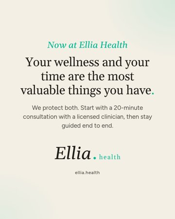

- **Format:** Single static
- **Hook:** Your wellness and your time are the most valuable things you have.
- **Buffer post id:** `6aeaaa64b8d162e0d8006c7a` (status: scheduled)
- **AI label (isAiGenerated):** OFF
- **Visual:** Type on cream #F4EFE5 with soft teal glow, Gelasio serif headline with teal end-punctuation, Figtree body, official Ellia Health logo (top, or large on the end card). No people, products or medical imagery.
- **Files:** `post-00-tonight/day-00-static-launch-wellness-and-time-01.jpg` ([raw](https://raw.githubusercontent.com/care803/ellia-social-assets/main/where-to-start/post-00-tonight/day-00-static-launch-wellness-and-time-01.jpg))

**Caption:**

```
Your wellness and your time are the most valuable things you have. Ellia Health protects both.

Now, it starts with a conversation: a 20-minute consultation with a licensed clinician. Unrushed, your questions answered, and a recommended path before you begin. From there, follow-ups and ongoing care keep you guided end to end, on your time.

Prefer to explore first? Our quiz is free.

Learn more at ellia.health
```

**On-slide text:**

1. Now at Ellia Health / Your wellness and your time are the most valuable things you have. / We protect both. Start with a 20-minute consultation with a licensed clinician, then stay guided end to end. [large official logo + ellia.health]

---

## post-01 · Wed 2026-11-04 · 8:00 AM PT

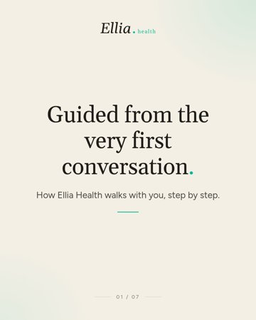

- **Format:** Carousel (7 slides)
- **Hook:** Guided from the very first conversation.
- **Buffer post id:** `6aeaab9eff887f055ce7dc83` (status: scheduled)
- **AI label (isAiGenerated):** OFF
- **Visual:** Type on cream #F4EFE5 with soft teal glow, Gelasio serif headline with teal end-punctuation, Figtree body, official Ellia Health logo (top, or large on the end card). No people, products or medical imagery.
- **Files:** `post-01/post-01-carousel-guided-end-to-end-01.jpg` ([raw](https://raw.githubusercontent.com/care803/ellia-social-assets/main/where-to-start/post-01/post-01-carousel-guided-end-to-end-01.jpg)), `post-01/post-01-carousel-guided-end-to-end-02.jpg` ([raw](https://raw.githubusercontent.com/care803/ellia-social-assets/main/where-to-start/post-01/post-01-carousel-guided-end-to-end-02.jpg)), `post-01/post-01-carousel-guided-end-to-end-03.jpg` ([raw](https://raw.githubusercontent.com/care803/ellia-social-assets/main/where-to-start/post-01/post-01-carousel-guided-end-to-end-03.jpg)), `post-01/post-01-carousel-guided-end-to-end-04.jpg` ([raw](https://raw.githubusercontent.com/care803/ellia-social-assets/main/where-to-start/post-01/post-01-carousel-guided-end-to-end-04.jpg)), `post-01/post-01-carousel-guided-end-to-end-05.jpg` ([raw](https://raw.githubusercontent.com/care803/ellia-social-assets/main/where-to-start/post-01/post-01-carousel-guided-end-to-end-05.jpg)), `post-01/post-01-carousel-guided-end-to-end-06.jpg` ([raw](https://raw.githubusercontent.com/care803/ellia-social-assets/main/where-to-start/post-01/post-01-carousel-guided-end-to-end-06.jpg)), `post-01/post-01-carousel-guided-end-to-end-07.jpg` ([raw](https://raw.githubusercontent.com/care803/ellia-social-assets/main/where-to-start/post-01/post-01-carousel-guided-end-to-end-07.jpg))

**Caption:**

```
Guided end to end.

It starts with 20 unrushed minutes with a licensed clinician and a recommended path before you begin. Then labs to track over time, follow-ups to revisit them together, and ongoing care that fits your schedule.

Never rushed, never on your own.

Prefer to explore first? The Ellia Health quiz is free.

Learn more at ellia.health
```

**On-slide text:**

1. Guided from the very first conversation. / How Ellia Health walks with you, step by step.
2. Start with 20 unrushed minutes. / A consultation with a licensed clinician, from home.
3. Hear a recommended path. / Before you begin, with your questions answered.
4. Labs to track over time. / Revisited together at your follow-ups.
5. Follow-ups and ongoing care. / On your schedule, so you're never on your own.
6. Prefer to explore first? / Our free quiz helps you see where to start.
7. Guided end to end. [large official logo + ellia.health]

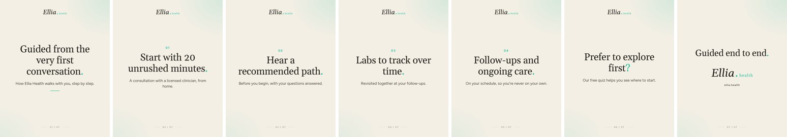

---

## post-02 · Wed 2026-11-04 · 12:30 PM PT

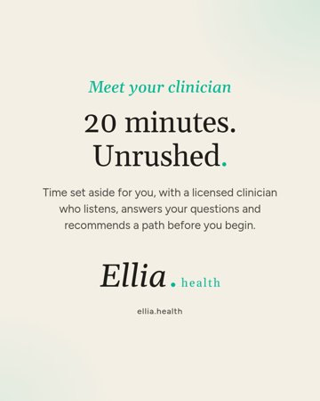

- **Format:** Single static
- **Hook:** 20 minutes. Unrushed.
- **Buffer post id:** `6aeaaba0ff887f055ce7dcd9` (status: scheduled)
- **AI label (isAiGenerated):** OFF
- **Visual:** Type on cream #F4EFE5 with soft teal glow, Gelasio serif headline with teal end-punctuation, Figtree body, official Ellia Health logo (top, or large on the end card). No people, products or medical imagery.
- **Files:** `post-02/post-02-static-20-minutes-unrushed-01.jpg` ([raw](https://raw.githubusercontent.com/care803/ellia-social-assets/main/where-to-start/post-02/post-02-static-20-minutes-unrushed-01.jpg))

**Caption:**

```
20 minutes. Unrushed.

Your first step at Ellia Health is a conversation with a licensed clinician. Time set aside for you to share what's on your mind, ask every question, and hear a recommended path before you begin.

Then you're guided from there, with follow-ups and ongoing care on your schedule.

Learn more at ellia.health
```

**On-slide text:**

1. Meet your clinician / 20 minutes. Unrushed. / Time set aside for you, with a licensed clinician who listens, answers your questions and recommends a path before you begin. [large official logo + ellia.health]

---

## post-03 · Wed 2026-11-04 · 6:30 PM PT


- **Format:** Avatar Reel (15 s, talent A)
- **Hook:** Not sure where to start? Start with a conversation.
- **Buffer post id:** `6aeaaba416e63068f190fde4` (status: scheduled)
- **AI label (isAiGenerated):** ON
- **Visual:** Talent A: woman with shoulder-length blonde hair, beige knit sweater, bright neutral living room. One continuous 15 s front-camera take (AI avatar, image-to-video), burned Figtree captions, official Ellia Health logo pill in the last 2 s. No products or medical imagery.
- **Files:** `post-03/post-03-reel-start-with-a-conversation.mp4` ([raw](https://raw.githubusercontent.com/care803/ellia-social-assets/main/where-to-start/post-03/post-03-reel-start-with-a-conversation.mp4))

**Caption:**

```
Not sure where to start? Start with a conversation.

Ellia Health now begins with a 20-minute consultation with a licensed clinician. Unrushed, your questions answered, and a recommended path before you begin. From there, you're guided through every next step.

Prefer to explore on your own first? Our quiz is free.

Learn more at ellia.health
```

**Reel script (40 words):** Not sure where to start? At Ellia Health, it begins with a twenty-minute consultation with a licensed clinician. Unrushed, your questions answered, and a recommended path before you begin. Guided from the first conversation. Or start with our free quiz.

**Final transcript (auto, Whisper):** Not sure where to start? At Elia Health, it begins with a 20 -minute consultation with a licensed clinician. Unrushed, your questions answered, and a recommended path before you begin. Guided from the first conversation. Or start with our free quiz.

On-screen text: burned captions of the script (numbers shown as '20'), plus the official logo pill at the end. No on-screen AI text.

---

## post-04 · Thu 2026-11-05 · 8:00 AM PT

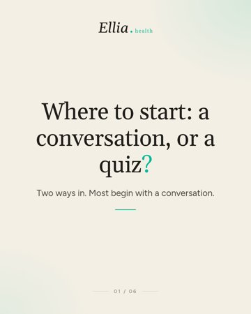

- **Format:** Carousel (6 slides)
- **Hook:** Where to start: a conversation, or a quiz?
- **Buffer post id:** `6aeaabc216e63068f1910224` (status: scheduled)
- **AI label (isAiGenerated):** OFF
- **Visual:** Type on cream #F4EFE5 with soft teal glow, Gelasio serif headline with teal end-punctuation, Figtree body, official Ellia Health logo (top, or large on the end card). No people, products or medical imagery.
- **Files:** `post-04/post-04-carousel-consult-or-quiz-01.jpg` ([raw](https://raw.githubusercontent.com/care803/ellia-social-assets/main/where-to-start/post-04/post-04-carousel-consult-or-quiz-01.jpg)), `post-04/post-04-carousel-consult-or-quiz-02.jpg` ([raw](https://raw.githubusercontent.com/care803/ellia-social-assets/main/where-to-start/post-04/post-04-carousel-consult-or-quiz-02.jpg)), `post-04/post-04-carousel-consult-or-quiz-03.jpg` ([raw](https://raw.githubusercontent.com/care803/ellia-social-assets/main/where-to-start/post-04/post-04-carousel-consult-or-quiz-03.jpg)), `post-04/post-04-carousel-consult-or-quiz-04.jpg` ([raw](https://raw.githubusercontent.com/care803/ellia-social-assets/main/where-to-start/post-04/post-04-carousel-consult-or-quiz-04.jpg)), `post-04/post-04-carousel-consult-or-quiz-05.jpg` ([raw](https://raw.githubusercontent.com/care803/ellia-social-assets/main/where-to-start/post-04/post-04-carousel-consult-or-quiz-05.jpg)), `post-04/post-04-carousel-consult-or-quiz-06.jpg` ([raw](https://raw.githubusercontent.com/care803/ellia-social-assets/main/where-to-start/post-04/post-04-carousel-consult-or-quiz-06.jpg))

**Caption:**

```
Consultation or quiz? Most begin with a conversation.

The consultation is 20 minutes with a licensed clinician: unrushed, your questions answered, and a recommended path before you begin. The quiz is free and quick, if you'd rather explore on your own time first.

Either way, Ellia Health guides you from there, with follow-ups and ongoing care on your schedule.

Learn more at ellia.health
```

**On-slide text:**

1. Where to start: a conversation, or a quiz? / Two ways in. Most begin with a conversation.
2. The consultation / 20 minutes with a licensed clinician.
3. The consultation / Unrushed, with your questions answered. / And a recommended path before you begin.
4. The free quiz / A quick way to explore first. / On your own time, whenever suits you.
5. Either way, you're guided from there. / Follow-ups and ongoing care, on your schedule.
6. Start with a conversation. [large official logo + ellia.health]

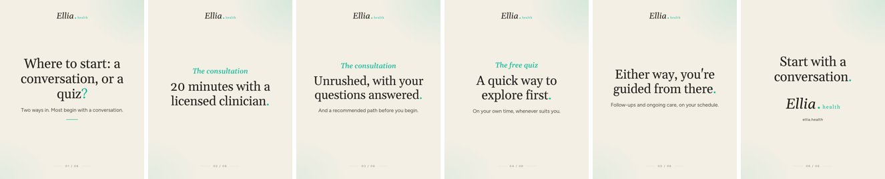

---

## post-05 · Thu 2026-11-05 · 12:30 PM PT

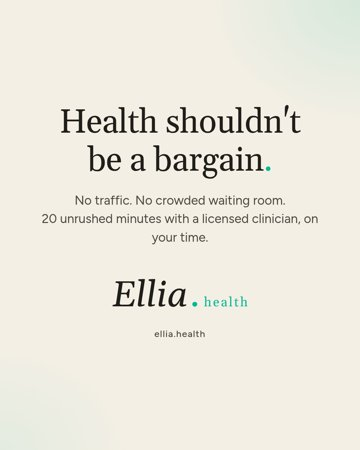

- **Format:** Single static
- **Hook:** Health shouldn't be a bargain.
- **Buffer post id:** `6aeaabc5ff887f055ce7e21d` (status: scheduled)
- **AI label (isAiGenerated):** OFF
- **Visual:** Type on cream #F4EFE5 with soft teal glow, Gelasio serif headline with teal end-punctuation, Figtree body, official Ellia Health logo (top, or large on the end card). No people, products or medical imagery.
- **Files:** `post-05/post-05-static-not-a-bargain-01.jpg` ([raw](https://raw.githubusercontent.com/care803/ellia-social-assets/main/where-to-start/post-05/post-05-static-not-a-bargain-01.jpg))

**Caption:**

```
Health shouldn't be a bargain.

No traffic. No crowded waiting room. No one watching the clock. Just 20 unrushed minutes with a licensed clinician, on your time, and follow-ups that keep you looked after.

This is the premium side of care at Ellia Health.

Learn more at ellia.health
```

**On-slide text:**

1. Health shouldn't be a bargain. / No traffic. No crowded waiting room. 20 unrushed minutes with a licensed clinician, on your time. [large official logo + ellia.health]

---

## post-06 · Thu 2026-11-05 · 6:30 PM PT

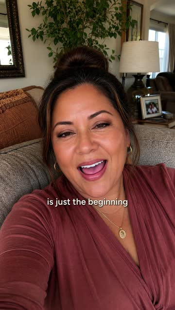

- **Format:** Avatar Reel (15 s, talent C)
- **Hook:** The first conversation is just the beginning.
- **Buffer post id:** `6aeab00eb8d162e0d8023121` (status: scheduled)
- **AI label (isAiGenerated):** ON
- **Visual:** Talent C: woman with dark hair in a bun, burgundy wrap top, cosy living room. One continuous 15 s front-camera take (AI avatar, image-to-video), burned Figtree captions, official Ellia Health logo pill in the last 2 s. No products or medical imagery.
- **Files:** `post-06/post-06-reel-first-conversation-is-the-beginning.mp4` ([raw](https://raw.githubusercontent.com/care803/ellia-social-assets/main/where-to-start/post-06/post-06-reel-first-conversation-is-the-beginning.mp4))

**Caption:**

```
The first conversation is just the beginning.

At Ellia Health, your licensed clinician recommends a path, then follow-ups keep it on track. You check in, ask what's on your mind, and adjust together.

Guided end to end, on your schedule.

Learn more at ellia.health
```

**Reel script (40 words):** The first conversation is just the beginning. At Ellia Health, your licensed clinician recommends a path, then follow-ups keep it on track. You check in, ask what's on your mind, and adjust together. Guided end to end, on your schedule.

**Final transcript (auto, Whisper):** The first conversation is just the beginning. At ELLIIA Health, your licensed clinician recommends a path, then follow -ups keep it on track. You check in, ask what's on your mind, and adjust together. Guided end -to -end on your schedule.

On-screen text: burned captions of the script (numbers shown as '20'), plus the official logo pill at the end. No on-screen AI text.

---

## post-07 · Fri 2026-11-06 · 8:00 AM PT

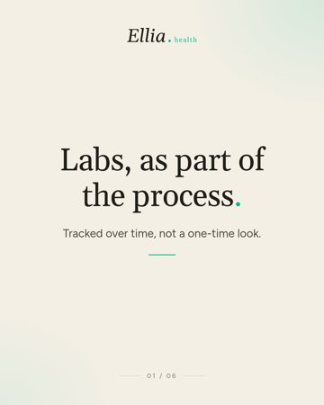

- **Format:** Carousel (6 slides)
- **Hook:** Labs, as part of the process.
- **Buffer post id:** `6aeaabcdff887f055ce7e2e1` (status: scheduled)
- **AI label (isAiGenerated):** OFF
- **Visual:** Type on cream #F4EFE5 with soft teal glow, Gelasio serif headline with teal end-punctuation, Figtree body, official Ellia Health logo (top, or large on the end card). No people, products or medical imagery.
- **Files:** `post-07/post-07-carousel-labs-over-time-01.jpg` ([raw](https://raw.githubusercontent.com/care803/ellia-social-assets/main/where-to-start/post-07/post-07-carousel-labs-over-time-01.jpg)), `post-07/post-07-carousel-labs-over-time-02.jpg` ([raw](https://raw.githubusercontent.com/care803/ellia-social-assets/main/where-to-start/post-07/post-07-carousel-labs-over-time-02.jpg)), `post-07/post-07-carousel-labs-over-time-03.jpg` ([raw](https://raw.githubusercontent.com/care803/ellia-social-assets/main/where-to-start/post-07/post-07-carousel-labs-over-time-03.jpg)), `post-07/post-07-carousel-labs-over-time-04.jpg` ([raw](https://raw.githubusercontent.com/care803/ellia-social-assets/main/where-to-start/post-07/post-07-carousel-labs-over-time-04.jpg)), `post-07/post-07-carousel-labs-over-time-05.jpg` ([raw](https://raw.githubusercontent.com/care803/ellia-social-assets/main/where-to-start/post-07/post-07-carousel-labs-over-time-05.jpg)), `post-07/post-07-carousel-labs-over-time-06.jpg` ([raw](https://raw.githubusercontent.com/care803/ellia-social-assets/main/where-to-start/post-07/post-07-carousel-labs-over-time-06.jpg))

**Caption:**

```
Labs at Ellia Health are part of the process, not a one-time look.

Your licensed clinician talks you through which labs fit your path and why, explains them in plain language, and revisits them with you at your follow-ups, so they're tracked over time.

Guided end to end, never on your own.

Learn more at ellia.health
```

**On-slide text:**

1. Labs, as part of the process. / Tracked over time, not a one-time look.
2. Talked through first. / Your clinician explains which labs fit your path, and why.
3. Explained in plain language. / So you know what you're looking at.
4. Revisited at your follow-ups. / Tracked together over time.
5. Never left to figure it out alone. / Questions welcome, every step of the way.
6. Labs to track over time. [large official logo + ellia.health]

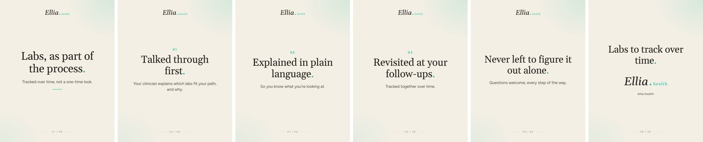

---

## post-08 · Fri 2026-11-06 · 12:30 PM PT

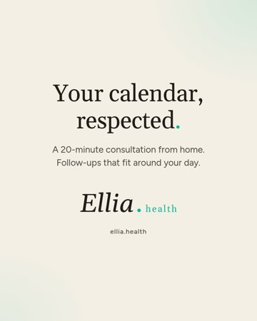

- **Format:** Single static
- **Hook:** Your calendar, respected.
- **Buffer post id:** `6aeaabd069ad1ef03b75ee6c` (status: scheduled)
- **AI label (isAiGenerated):** OFF
- **Visual:** Type on cream #F4EFE5 with soft teal glow, Gelasio serif headline with teal end-punctuation, Figtree body, official Ellia Health logo (top, or large on the end card). No people, products or medical imagery.
- **Files:** `post-08/post-08-static-calendar-respected-01.jpg` ([raw](https://raw.githubusercontent.com/care803/ellia-social-assets/main/where-to-start/post-08/post-08-static-calendar-respected-01.jpg))

**Caption:**

```
Your calendar, respected.

Your time is one of the most valuable things you have. At Ellia Health, it starts with a 20-minute consultation from home, then follow-ups that fit around your day. No commute, no clipboard, no clock-watching.

Learn more at ellia.health
```

**On-slide text:**

1. Your calendar, respected. / A 20-minute consultation from home. Follow-ups that fit around your day. [large official logo + ellia.health]

---

## post-09 · Fri 2026-11-06 · 6:30 PM PT

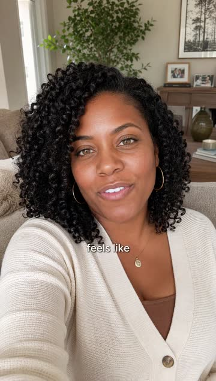

- **Format:** Avatar Reel (15 s, talent B)
- **Hook:** Here's what 20 minutes with a clinician at Ellia Health feels like.
- **Buffer post id:** `6aeaabd3ff887f055ce7e3fa` (status: scheduled)
- **AI label (isAiGenerated):** ON
- **Visual:** Talent B: woman with curly black hair, cream cardigan, living room with plants and framed art. One continuous 15 s front-camera take (AI avatar, image-to-video), burned Figtree captions, official Ellia Health logo pill in the last 2 s. No products or medical imagery.
- **Files:** `post-09/post-09-reel-what-20-minutes-feels-like.mp4` ([raw](https://raw.githubusercontent.com/care803/ellia-social-assets/main/where-to-start/post-09/post-09-reel-what-20-minutes-feels-like.mp4))

**Caption:**

```
What 20 minutes with a clinician at Ellia Health feels like.

Nobody's rushing you. You talk it through from home, ask every question on your list, and leave with a clear next step. Then follow-ups, so you're never on your own.

Learn more at ellia.health
```

**Reel script (42 words):** Here's what twenty minutes with a clinician at Ellia Health feels like. Nobody's rushing you. You talk it through from home, ask every question on your list, and leave with a clear next step. Then follow-ups, so you're never on your own.

**Final transcript (auto, Whisper):** Here's what 20 minutes with a clinician at Ellia Health feels like. Nobody's rushing you. You talk it through from home, ask every question on your list, and leave with a clear next step. Then follow -ups so you're never on your own.

On-screen text: burned captions of the script (numbers shown as '20'), plus the official logo pill at the end. No on-screen AI text.

---

## post-10 · Sat 2026-11-07 · 8:00 AM PT

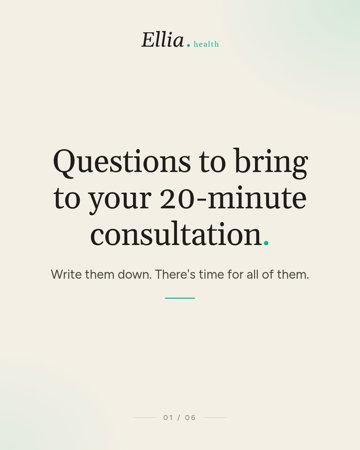

- **Format:** Carousel (6 slides)
- **Hook:** Questions to bring to your 20-minute consultation.
- **Buffer post id:** `6aeaabdbb8d162e0d800d5ab` (status: scheduled)
- **AI label (isAiGenerated):** OFF
- **Visual:** Type on cream #F4EFE5 with soft teal glow, Gelasio serif headline with teal end-punctuation, Figtree body, official Ellia Health logo (top, or large on the end card). No people, products or medical imagery.
- **Files:** `post-10/post-10-carousel-questions-to-bring-01.jpg` ([raw](https://raw.githubusercontent.com/care803/ellia-social-assets/main/where-to-start/post-10/post-10-carousel-questions-to-bring-01.jpg)), `post-10/post-10-carousel-questions-to-bring-02.jpg` ([raw](https://raw.githubusercontent.com/care803/ellia-social-assets/main/where-to-start/post-10/post-10-carousel-questions-to-bring-02.jpg)), `post-10/post-10-carousel-questions-to-bring-03.jpg` ([raw](https://raw.githubusercontent.com/care803/ellia-social-assets/main/where-to-start/post-10/post-10-carousel-questions-to-bring-03.jpg)), `post-10/post-10-carousel-questions-to-bring-04.jpg` ([raw](https://raw.githubusercontent.com/care803/ellia-social-assets/main/where-to-start/post-10/post-10-carousel-questions-to-bring-04.jpg)), `post-10/post-10-carousel-questions-to-bring-05.jpg` ([raw](https://raw.githubusercontent.com/care803/ellia-social-assets/main/where-to-start/post-10/post-10-carousel-questions-to-bring-05.jpg)), `post-10/post-10-carousel-questions-to-bring-06.jpg` ([raw](https://raw.githubusercontent.com/care803/ellia-social-assets/main/where-to-start/post-10/post-10-carousel-questions-to-bring-06.jpg))

**Caption:**

```
Questions to bring to your 20-minute consultation.

Where's the right place for me to start? What would you recommend first, and why? How will our follow-ups work? What should we track over time?

Your licensed clinician at Ellia Health sets the time aside for all of them. Save this for later.

Learn more at ellia.health
```

**On-slide text:**

1. Questions to bring to your 20-minute consultation. / Write them down. There's time for all of them.
2. Where's the right place for me to start?
3. What would you recommend first, and why?
4. How will our follow-ups work?
5. What should we track over time?
6. Bring every question. We have time. [large official logo + ellia.health]

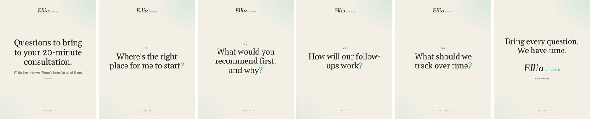

---

## post-11 · Sat 2026-11-07 · 12:30 PM PT

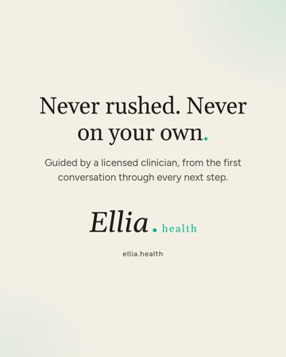

- **Format:** Single static
- **Hook:** Never rushed. Never on your own.
- **Buffer post id:** `6aeaabdeb8d162e0d800d5eb` (status: scheduled)
- **AI label (isAiGenerated):** OFF
- **Visual:** Type on cream #F4EFE5 with soft teal glow, Gelasio serif headline with teal end-punctuation, Figtree body, official Ellia Health logo (top, or large on the end card). No people, products or medical imagery.
- **Files:** `post-11/post-11-static-never-rushed-never-alone-01.jpg` ([raw](https://raw.githubusercontent.com/care803/ellia-social-assets/main/where-to-start/post-11/post-11-static-never-rushed-never-alone-01.jpg))

**Caption:**

```
Never rushed. Never on your own.

At Ellia Health, you're guided by a licensed clinician from the first conversation through every next step, with follow-ups and ongoing care along the way.

Learn more at ellia.health
```

**On-slide text:**

1. Never rushed. Never on your own. / Guided by a licensed clinician, from the first conversation through every next step. [large official logo + ellia.health]

---

## post-12 · Sat 2026-11-07 · 6:30 PM PT


- **Format:** Avatar Reel (15 s, talent A)
- **Hook:** Your time matters as much as your wellness.
- **Buffer post id:** `6aeab01069ad1ef03b7746e7` (status: scheduled)
- **AI label (isAiGenerated):** ON
- **Visual:** Talent A: woman with shoulder-length blonde hair, beige knit sweater, bright neutral living room. One continuous 15 s front-camera take (AI avatar, image-to-video), burned Figtree captions, official Ellia Health logo pill in the last 2 s. No products or medical imagery.
- **Files:** `post-12/post-12-reel-time-matters.mp4` ([raw](https://raw.githubusercontent.com/care803/ellia-social-assets/main/where-to-start/post-12/post-12-reel-time-matters.mp4))

**Caption:**

```
Your time matters as much as your wellness.

That's why Ellia Health starts from home: 20 unrushed minutes with a licensed clinician, no traffic, no waiting room. Then follow-ups that fit around your week, not the other way around.

Learn more at ellia.health
```

**Reel script (39 words):** Your time matters as much as your wellness. That's why Ellia Health starts from home. Twenty unrushed minutes with a licensed clinician, no traffic, no waiting room. Then follow-ups that fit around your week, not the other way around.

**Final transcript (auto, Whisper):** Your time matters as much as your wellness. That's why Ellia Health starts from home. 20 unrushed minutes with a licensed clinician, no traffic, no waiting room. Then follow -ups that fit around your week, not the other way around.

On-screen text: burned captions of the script (numbers shown as '20'), plus the official logo pill at the end. No on-screen AI text.

---

## post-13 · Sun 2026-11-08 · 8:00 AM PT

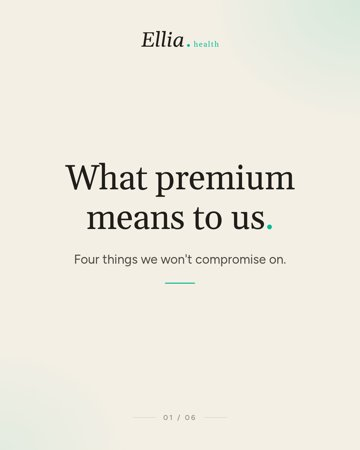

- **Format:** Carousel (6 slides)
- **Hook:** What premium means to us.
- **Buffer post id:** `6aeaabe587b7c6d24c8b9330` (status: scheduled)
- **AI label (isAiGenerated):** OFF
- **Visual:** Type on cream #F4EFE5 with soft teal glow, Gelasio serif headline with teal end-punctuation, Figtree body, official Ellia Health logo (top, or large on the end card). No people, products or medical imagery.
- **Files:** `post-13/post-13-carousel-what-premium-means-01.jpg` ([raw](https://raw.githubusercontent.com/care803/ellia-social-assets/main/where-to-start/post-13/post-13-carousel-what-premium-means-01.jpg)), `post-13/post-13-carousel-what-premium-means-02.jpg` ([raw](https://raw.githubusercontent.com/care803/ellia-social-assets/main/where-to-start/post-13/post-13-carousel-what-premium-means-02.jpg)), `post-13/post-13-carousel-what-premium-means-03.jpg` ([raw](https://raw.githubusercontent.com/care803/ellia-social-assets/main/where-to-start/post-13/post-13-carousel-what-premium-means-03.jpg)), `post-13/post-13-carousel-what-premium-means-04.jpg` ([raw](https://raw.githubusercontent.com/care803/ellia-social-assets/main/where-to-start/post-13/post-13-carousel-what-premium-means-04.jpg)), `post-13/post-13-carousel-what-premium-means-05.jpg` ([raw](https://raw.githubusercontent.com/care803/ellia-social-assets/main/where-to-start/post-13/post-13-carousel-what-premium-means-05.jpg)), `post-13/post-13-carousel-what-premium-means-06.jpg` ([raw](https://raw.githubusercontent.com/care803/ellia-social-assets/main/where-to-start/post-13/post-13-carousel-what-premium-means-06.jpg))

**Caption:**

```
What premium means at Ellia Health.

Time: 20 unrushed minutes, never a countdown. Attention: a licensed clinician who listens. Continuity: follow-ups and ongoing care. Convenience: from home, on your schedule.

Health shouldn't be a bargain, and your time shouldn't be either.

Learn more at ellia.health
```

**On-slide text:**

1. What premium means to us. / Four things we won't compromise on.
2. Time / 20 unrushed minutes, never a countdown.
3. Attention / A licensed clinician who listens.
4. Continuity / Follow-ups and ongoing care.
5. Convenience / From home, on your schedule.
6. Premium, because your time matters. [large official logo + ellia.health]

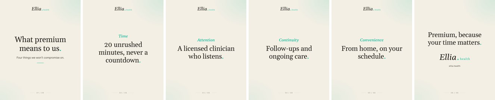

---

## post-14 · Sun 2026-11-08 · 12:30 PM PT

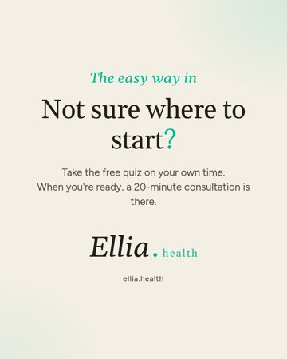

- **Format:** Single static
- **Hook:** Not sure where to start?
- **Buffer post id:** `6aeaabe9b8d162e0d800d794` (status: scheduled)
- **AI label (isAiGenerated):** OFF
- **Visual:** Type on cream #F4EFE5 with soft teal glow, Gelasio serif headline with teal end-punctuation, Figtree body, official Ellia Health logo (top, or large on the end card). No people, products or medical imagery.
- **Files:** `post-14/post-14-static-free-quiz-01.jpg` ([raw](https://raw.githubusercontent.com/care803/ellia-social-assets/main/where-to-start/post-14/post-14-static-free-quiz-01.jpg))

**Caption:**

```
Not sure where to start?

The Ellia Health quiz is free and quick, a calm way to explore on your own time. When you'd like to talk it through, a 20-minute consultation with a licensed clinician is there, and you're guided from that first conversation on.

Learn more at ellia.health
```

**On-slide text:**

1. The easy way in / Not sure where to start? / Take the free quiz on your own time. When you're ready, a 20-minute consultation is there. [large official logo + ellia.health]

---

## post-15 · Sun 2026-11-08 · 6:30 PM PT

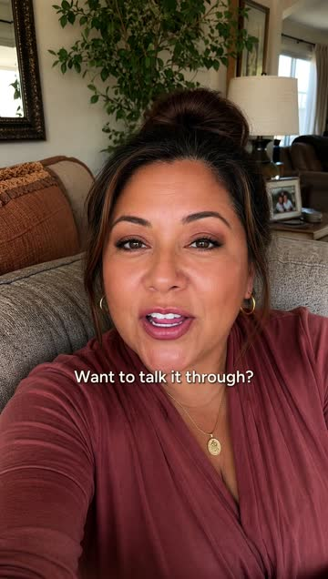

- **Format:** Avatar Reel (15 s, talent C)
- **Hook:** Two ways to start at Ellia Health.
- **Buffer post id:** `6aeab01416e63068f1925542` (status: scheduled)
- **AI label (isAiGenerated):** ON
- **Visual:** Talent C: woman with dark hair in a bun, burgundy wrap top, cosy living room. One continuous 15 s front-camera take (AI avatar, image-to-video), burned Figtree captions, official Ellia Health logo pill in the last 2 s. No products or medical imagery.
- **Files:** `post-15/post-15-reel-two-ways-to-start.mp4` ([raw](https://raw.githubusercontent.com/care803/ellia-social-assets/main/where-to-start/post-15/post-15-reel-two-ways-to-start.mp4))

**Caption:**

```
Two ways to start at Ellia Health.

Want to talk it through? Book a 20-minute consultation with a licensed clinician. Rather explore first? Take the free quiz on your own time. Either way, you're guided every step from there.

Learn more at ellia.health
```

**Reel script (39 words):** Two ways to start at Ellia Health. Want to talk it through? Book a twenty-minute consultation with a licensed clinician. Rather explore first? Take the free quiz on your own time. Either way, you're guided every step from there.

**Final transcript (auto, Whisper):** Two ways to start at Ellia Health. Want to talk it through? Book a 20 -minute consultation with a licensed clinician. Rather explore first? Take the free quiz on your own time. Either way, you're guided every step from there.

On-screen text: burned captions of the script (numbers shown as '20'), plus the official logo pill at the end. No on-screen AI text.

---

## post-16 · Mon 2026-11-09 · 8:00 AM PT

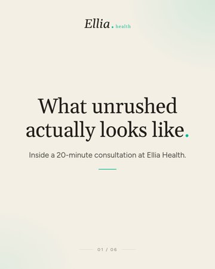

- **Format:** Carousel (6 slides)
- **Hook:** What unrushed actually looks like.
- **Buffer post id:** `6aeaabf1ff887f055ce7e731` (status: scheduled)
- **AI label (isAiGenerated):** OFF
- **Visual:** Type on cream #F4EFE5 with soft teal glow, Gelasio serif headline with teal end-punctuation, Figtree body, official Ellia Health logo (top, or large on the end card). No people, products or medical imagery.
- **Files:** `post-16/post-16-carousel-what-unrushed-looks-like-01.jpg` ([raw](https://raw.githubusercontent.com/care803/ellia-social-assets/main/where-to-start/post-16/post-16-carousel-what-unrushed-looks-like-01.jpg)), `post-16/post-16-carousel-what-unrushed-looks-like-02.jpg` ([raw](https://raw.githubusercontent.com/care803/ellia-social-assets/main/where-to-start/post-16/post-16-carousel-what-unrushed-looks-like-02.jpg)), `post-16/post-16-carousel-what-unrushed-looks-like-03.jpg` ([raw](https://raw.githubusercontent.com/care803/ellia-social-assets/main/where-to-start/post-16/post-16-carousel-what-unrushed-looks-like-03.jpg)), `post-16/post-16-carousel-what-unrushed-looks-like-04.jpg` ([raw](https://raw.githubusercontent.com/care803/ellia-social-assets/main/where-to-start/post-16/post-16-carousel-what-unrushed-looks-like-04.jpg)), `post-16/post-16-carousel-what-unrushed-looks-like-05.jpg` ([raw](https://raw.githubusercontent.com/care803/ellia-social-assets/main/where-to-start/post-16/post-16-carousel-what-unrushed-looks-like-05.jpg)), `post-16/post-16-carousel-what-unrushed-looks-like-06.jpg` ([raw](https://raw.githubusercontent.com/care803/ellia-social-assets/main/where-to-start/post-16/post-16-carousel-what-unrushed-looks-like-06.jpg))

**Caption:**

```
What unrushed actually looks like.

No clock-watching: twenty minutes set aside for you. No question too small: bring your list. No guessing what's next: a recommended path before you begin. No starting over: follow-ups that pick up where you left off.

That's a consultation with a licensed clinician at Ellia Health.

Learn more at ellia.health
```

**On-slide text:**

1. What unrushed actually looks like. / Inside a 20-minute consultation at Ellia Health.
2. No clock-watching. / Twenty minutes set aside for you.
3. No question too small. / Bring your list. Ask it all.
4. No guessing what's next. / A recommended path before you begin.
5. No starting over. / Follow-ups that pick up where you left off.
6. Unrushed, end to end. [large official logo + ellia.health]

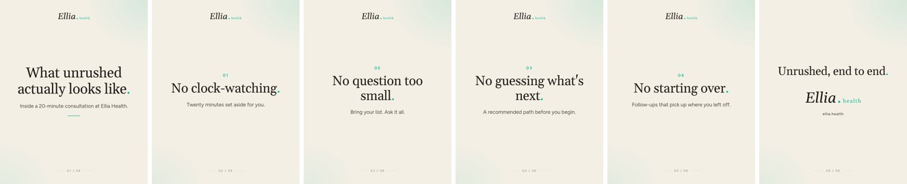

---

## post-17 · Mon 2026-11-09 · 12:30 PM PT

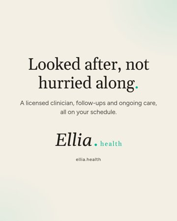

- **Format:** Single static
- **Hook:** Looked after, not hurried along.
- **Buffer post id:** `6aeaabf416e63068f1910b30` (status: scheduled)
- **AI label (isAiGenerated):** OFF
- **Visual:** Type on cream #F4EFE5 with soft teal glow, Gelasio serif headline with teal end-punctuation, Figtree body, official Ellia Health logo (top, or large on the end card). No people, products or medical imagery.
- **Files:** `post-17/post-17-static-looked-after-01.jpg` ([raw](https://raw.githubusercontent.com/care803/ellia-social-assets/main/where-to-start/post-17/post-17-static-looked-after-01.jpg))

**Caption:**

```
Looked after, not hurried along.

At Ellia Health, care doesn't end when the first conversation does. Your licensed clinician stays with you through follow-ups and ongoing care, all on your schedule.

Learn more at ellia.health
```

**On-slide text:**

1. Looked after, not hurried along. / A licensed clinician, follow-ups and ongoing care, all on your schedule. [large official logo + ellia.health]

---

## post-18 · Mon 2026-11-09 · 6:30 PM PT

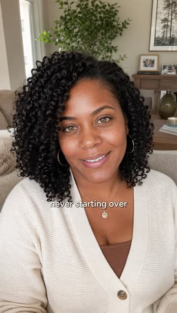

- **Format:** Avatar Reel (15 s, talent B)
- **Hook:** Ongoing care means you're never starting over.
- **Buffer post id:** `6aeab017ff887f055ce944d8` (status: scheduled)
- **AI label (isAiGenerated):** ON
- **Visual:** Talent B: woman with curly black hair, cream cardigan, living room with plants and framed art. One continuous 15 s front-camera take (AI avatar, image-to-video), burned Figtree captions, official Ellia Health logo pill in the last 2 s. No products or medical imagery.
- **Files:** `post-18/post-18-reel-never-starting-over.mp4` ([raw](https://raw.githubusercontent.com/care803/ellia-social-assets/main/where-to-start/post-18/post-18-reel-never-starting-over.mp4))

**Caption:**

```
Ongoing care means you're never starting over.

At Ellia Health, there are labs to track over time, revisited with your clinician at follow-ups, so each conversation picks up where the last one left off.

Never rushed, never on your own.

Learn more at ellia.health
```

**Reel script (40 words):** Ongoing care means you're never starting over. At Ellia Health, there are labs to track over time, revisited with your clinician at follow-ups, so each conversation picks up where the last one left off. Never rushed, never on your own.

**Final transcript (auto, Whisper):** Ongoing care means you're never starting over. At ELLIIA Health, there are labs to track over time, revisited with your clinician at follow -ups, so each conversation picks up where the last one left off. Never rushed, never on your own.

On-screen text: burned captions of the script (numbers shown as '20'), plus the official logo pill at the end. No on-screen AI text.

---

## post-19 · Tue 2026-11-10 · 8:00 AM PT

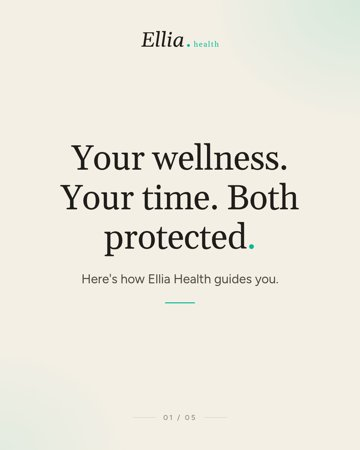

- **Format:** Carousel (5 slides)
- **Hook:** Your wellness. Your time. Both protected.
- **Buffer post id:** `6aeaabfb16e63068f1910bf3` (status: scheduled)
- **AI label (isAiGenerated):** OFF
- **Visual:** Type on cream #F4EFE5 with soft teal glow, Gelasio serif headline with teal end-punctuation, Figtree body, official Ellia Health logo (top, or large on the end card). No people, products or medical imagery.
- **Files:** `post-19/post-19-carousel-recap-01.jpg` ([raw](https://raw.githubusercontent.com/care803/ellia-social-assets/main/where-to-start/post-19/post-19-carousel-recap-01.jpg)), `post-19/post-19-carousel-recap-02.jpg` ([raw](https://raw.githubusercontent.com/care803/ellia-social-assets/main/where-to-start/post-19/post-19-carousel-recap-02.jpg)), `post-19/post-19-carousel-recap-03.jpg` ([raw](https://raw.githubusercontent.com/care803/ellia-social-assets/main/where-to-start/post-19/post-19-carousel-recap-03.jpg)), `post-19/post-19-carousel-recap-04.jpg` ([raw](https://raw.githubusercontent.com/care803/ellia-social-assets/main/where-to-start/post-19/post-19-carousel-recap-04.jpg)), `post-19/post-19-carousel-recap-05.jpg` ([raw](https://raw.githubusercontent.com/care803/ellia-social-assets/main/where-to-start/post-19/post-19-carousel-recap-05.jpg))

**Caption:**

```
Your wellness and your time are the most valuable things you have. Ellia Health protects both.

A 20-minute consultation with a licensed clinician. A recommended path before you begin. Labs to track over time, revisited at your follow-ups. Ongoing care, on your schedule.

Guided end to end, and never rushed. Or start with the free quiz.

Learn more at ellia.health
```

**On-slide text:**

1. Your wellness. Your time. Both protected. / Here's how Ellia Health guides you.
2. A 20-minute consultation. / With a licensed clinician, unrushed. A recommended path before you begin.
3. Labs to track over time. / Revisited together at each follow-up.
4. Ongoing care, on your time. / From home, on your schedule. Or start with the free quiz.
5. Guided end to end. [large official logo + ellia.health]

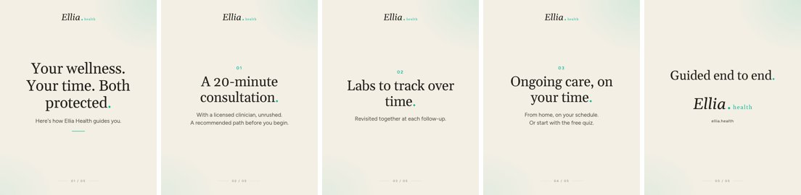

---

## post-20 · Tue 2026-11-10 · 12:30 PM PT

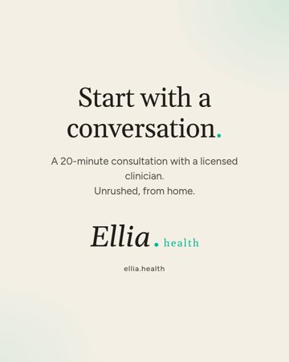

- **Format:** Single static
- **Hook:** Start with a conversation.
- **Buffer post id:** `6aeaabfeff887f055ce7e83c` (status: scheduled)
- **AI label (isAiGenerated):** OFF
- **Visual:** Type on cream #F4EFE5 with soft teal glow, Gelasio serif headline with teal end-punctuation, Figtree body, official Ellia Health logo (top, or large on the end card). No people, products or medical imagery.
- **Files:** `post-20/post-20-static-start-with-a-conversation-01.jpg` ([raw](https://raw.githubusercontent.com/care803/ellia-social-assets/main/where-to-start/post-20/post-20-static-start-with-a-conversation-01.jpg))

**Caption:**

```
Start with a conversation.

A 20-minute consultation with a licensed clinician, unrushed and from home. Share what's on your mind, ask your questions, and hear a recommended path before you begin. From there, Ellia Health guides you through every next step.

Learn more at ellia.health
```

**On-slide text:**

1. Start with a conversation. / A 20-minute consultation with a licensed clinician. Unrushed, from home. [large official logo + ellia.health]

---

## post-21 · Tue 2026-11-10 · 6:30 PM PT


- **Format:** Avatar Reel (15 s, talent A)
- **Hook:** Your wellness and your time are the most valuable things you have.
- **Buffer post id:** `6aeab01a16e63068f1925684` (status: scheduled)
- **AI label (isAiGenerated):** ON
- **Visual:** Talent A: woman with shoulder-length blonde hair, beige knit sweater, bright neutral living room. One continuous 15 s front-camera take (AI avatar, image-to-video), burned Figtree captions, official Ellia Health logo pill in the last 2 s. No products or medical imagery.
- **Files:** `post-21/post-21-reel-wellness-and-time-closing.mp4` ([raw](https://raw.githubusercontent.com/care803/ellia-social-assets/main/where-to-start/post-21/post-21-reel-wellness-and-time-closing.mp4))

**Caption:**

```
Your wellness and your time are the most valuable things you have. Ellia Health protects both.

Start with a 20-minute conversation with a licensed clinician, and from there, you're guided through every next step. Whenever you're ready, we're here.

Learn more at ellia.health
```

**Reel script (39 words):** Your wellness and your time are the most valuable things you have. Ellia Health protects both. Start with a twenty-minute conversation with a licensed clinician, and from there, you're guided through every next step. Whenever you're ready, we're here.

**Final transcript (auto, Whisper):** Your wellness and your time are the most valuable things you have. Ellia Health protects both. Start with a 20 -minute conversation with a licensed clinician, and from there, you're guided through every next step. Whenever you're ready, we're here.

On-screen text: burned captions of the script (numbers shown as '20'), plus the official logo pill at the end. No on-screen AI text.
